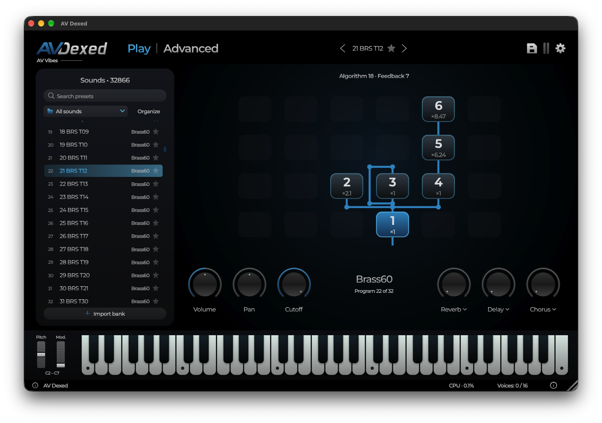
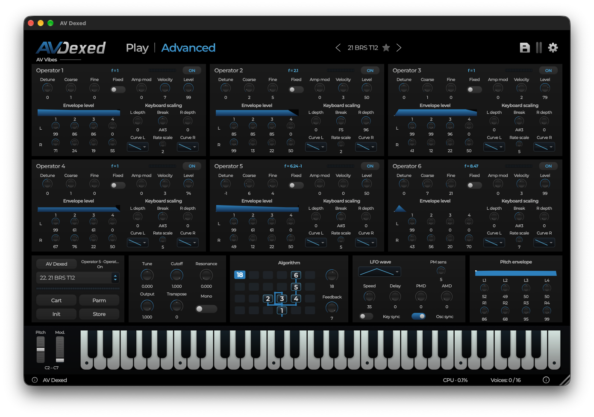
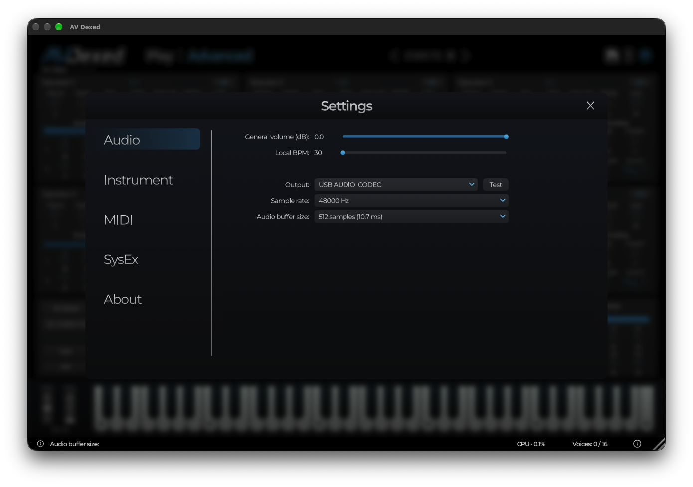
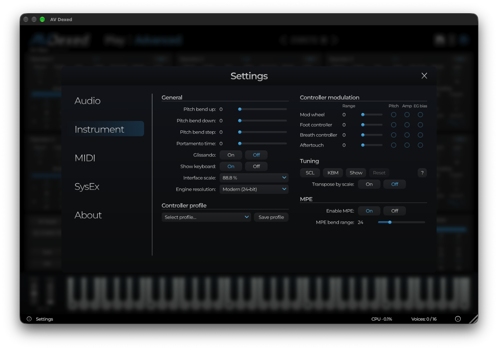
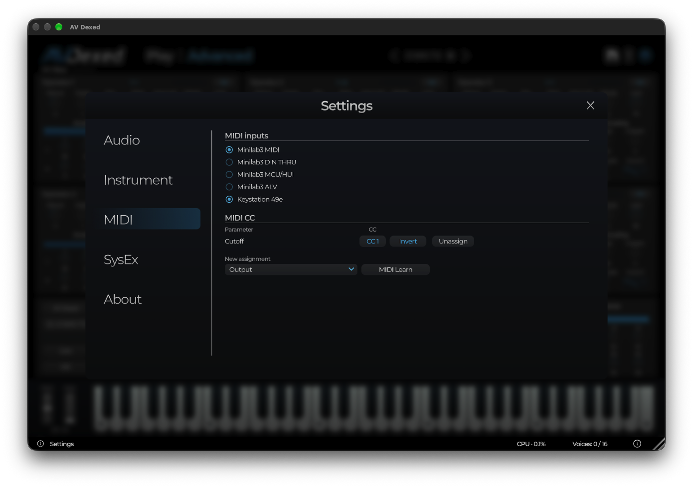
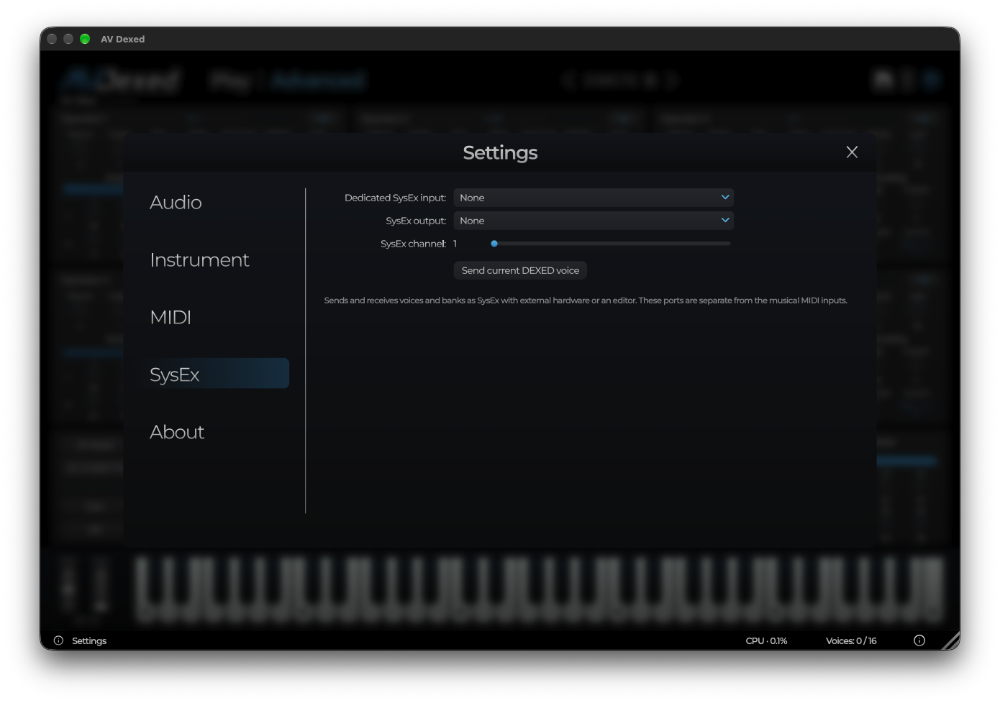
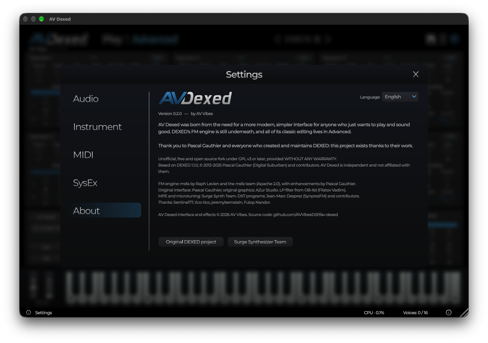

<h1 align="center">
  <picture>
    <source media="(prefers-color-scheme: dark)" srcset="assets/branding/AVDexed_Logo.svg">
    
  </picture>
</h1>

AV Dexed is a free, unofficial fork of [Dexed](https://github.com/asb2m10/dexed), the DX7-style FM synthesizer by
Pascal Gauthier (Digital Suburban). It keeps Dexed's FM engine and all of its classic editing, and adds a simpler
interface for people who just want to play and sound good.

**Version 0.2.0 — public preview.** Download it from
[Releases](https://github.com/AVVibesDSP/av-dexed/releases/latest):

- **macOS:** the `.dmg` (macOS 11 or later, Intel and Apple silicon; app, VST3, AU and CLAP). It is not signed or
  notarized by Apple yet: open `1 - HOW TO OPEN - CÓMO ABRIR.txt` in the disk image first.
- **Windows:** the `-win.exe` installer (Windows 10 or 11, x64; app, VST3 and CLAP). It is not signed yet: if Windows
  says "Windows protected your PC", choose *More info*, then *Run anyway*.
- **Linux:** build from source.

<p align="center">
  
  
</p>
<p align="center"><em>Play</em> &nbsp;·&nbsp; <em>Advanced</em></p>
<p align="center">
  
  
  
</p>
<p align="center">
  
  
</p>
<p align="center"><em>Settings: Audio · Instrument · MIDI · SysEx · About</em></p>

> AV Dexed is a modified version of Dexed 1.1.0 (asb2m10/dexed, base commit `eebb748`), modified by AV Vibes since
> October 2026; the git history shows every change. It is not affiliated with or endorsed by Pascal Gauthier /
> Digital Suburban. Please report AV Dexed problems in this repository, not to the original project.

## What is different

- **Play view:** a sound browser with search, favorites and real folders; the FM algorithm in the center, where each
  operator lights up while it sounds and opens in Advanced with a click; Volume, Pan and Cutoff, plus Reverb, Delay and
  Chorus.
- **A library made of real folders:** every folder in the browser is a folder on disk, and the other way round. Drop
  `.syx` banks, `.avdexpreset` sounds or whole folders on AV Dexed (or use *Import bank*) and they are copied into it.
- **Advanced view:** every classic Dexed parameter, redrawn.
- **Built-in effects:** reverb, tempo-synced delay and chorus. Each sound keeps its own volume, pan, cutoff and
  effects, also the voices of a `.syx` bank (see below).
- **Settings:** audio output, instrument options, MIDI inputs, MIDI CC assignments (with invert), SysEx, and About.
- **English and Spanish** interface.
- **Its own plugin identifiers and data folder**, so it can be installed next to the original Dexed.

## User data and compatibility

On macOS the sound library is the folder `~/Library/Application Support/AV Vibes/AV Dexed` itself (Windows:
`%APPDATA%\AV Vibes\AV Dexed`): each folder in it is a folder of the browser. The factory sounds live in
`Dexed Factory` and `SynprezFM` (read-only; *Save as…* keeps your changes in your own folder). Preferences are in
`AV Dexed Preferences.xml`. On first launch AV Dexed copies missing settings and banks from the original Dexed folder
(`~/Library/Application Support/DigitalSuburban/Dexed`) without deleting or overwriting anything; 0.1.0 data is moved
into the new layout, and anything replaced is kept in the hidden `.migration-backup` folder.

Existing banks and presets keep working. AV Dexed's own `.avdexpreset` files store one whole sound (until 0.2.0 they
were called `.dexedpreset`; those still open and are renamed in the library). A `.syx` bank stays a
standard DX7 bank: the volume, pan, cutoff and effect settings of its voices are stored after the bank as one extra
SysEx message (manufacturer ID `7D`, non-commercial) that a DX7 and other editors ignore. Because AV Dexed has its own
plugin identifiers, it does not replace an original Dexed instance in an existing DAW project.

Bank voices load exactly as in Dexed 1.1.0, including values beyond the documented ranges that real DX7 banks hold
(for example an output level of 102), with two exceptions: bit 7 of the operator bytes is ignored (a MIDI data byte
never has it), and an LFO speed or delay above 99 is limited to 99 (Dexed 1.1.0 reads past its 100-entry tables
there). Single-voice SysEx dumps, sound files and DAW sessions follow the same rule.

## Build

Requirements: CMake 3.22 or newer and a C++17 compiler (on macOS, Xcode or the Command Line Tools).

```sh
git clone --recursive https://github.com/AVVibesDSP/av-dexed.git
cd av-dexed
cmake -S . -B build -DCMAKE_BUILD_TYPE=Release
cmake --build build --config Release
```

Targets: Standalone, VST3 and CLAP, plus AU on macOS. Results are in `build/source/AVDexed_artefacts/`. Plugins are not
copied into your plugin folders unless you add `-DDEXED_COPY_PLUGIN_AFTER_BUILD=ON`. The `libs/JUCE` submodule is
JUCE 8.0.14; to use another JUCE 8 checkout, pass `-DDEXED_JUCE_PATH=/path/to/JUCE`. Add `-DDEXED_BUILD_TESTS=ON` to
build the regression tests. AV Dexed is developed and tested on macOS and also builds and runs on Windows 11 (see
below); Linux builds are untested. `Dexed.jucer` is not maintained — use CMake. The macOS installer is made with
[packaging/macos/build_installer.sh](packaging/macos/README.md).

### Windows

Tested on Windows 11 x64 with Visual Studio 2026 (workload *Desktop development with C++*, which includes CMake). In
a *Developer PowerShell for VS 2026*:

```sh
cmake -S . -B build-release -G "Visual Studio 18 2026" -A x64
cmake --build build-release --config Release
```

Visual Studio chooses the configuration when building (`--config Release`), so `CMAKE_BUILD_TYPE` is not needed.
Build the regression tests in another folder, because they change the plugin build: the same two lines with
`-B build -DDEXED_BUILD_TESTS=ON` and `build`, then `ctest --test-dir build -C Release`. The standalone app can use
ASIO drivers as well as Windows Audio and DirectSound (JUCE's bundled ASIO SDK, under its GPLv3 option).

With [Inno Setup](https://jrsoftware.org/isinfo.php) 6.3 or newer installed, add `--target installer` to the build line
to make `build-release/installer/AVDexed-<version>-win.exe` (and a `.zip` of the same files). Its first step chooses
English or Spanish; it installs the VST3 in `C:\Program Files\Common Files\VST3`, the CLAP in `C:\Program Files\Common Files\CLAP` and the
app in `C:\Program Files\AV Dexed`. Setup and Uninstall never touch the sounds and settings in
`%APPDATA%\AV Vibes\AV Dexed`. The installer is not signed yet: if Windows says "Windows protected your PC", choose
*More info*, then *Run anyway*.

## License

AV Dexed is free software under the GNU General Public License, version 3 or later ([LICENSE](LICENSE)), and comes
**without any warranty**. The `source/msfa` engine stays under the Apache License 2.0, JUCE 8 is used under its AGPLv3
open-source option, and the embedded Montserrat fonts use the SIL Open Font License 1.1 (license texts:
[LICENSE](LICENSE), [source/msfa/LICENSE](source/msfa/LICENSE), [assets/fonts/OFL.txt](assets/fonts/OFL.txt)). See
[third-party notices](doc/THIRD_PARTY_NOTICES.md) for every component.

Yamaha and DX7 are trademarks of Yamaha Corporation. AV Dexed is not affiliated with Yamaha.

## Credits & thanks

AV Dexed exists thanks to Dexed and the people who made it. Original Dexed credits:

* DX Synth engine : Raph Levien and the [msfa](https://github.com/google/music-synthesizer-for-android) team
* [Surge Synth Team](https://surge-synth-team.org/) for substantial contributions like microtuning and MPE support.
* Graphical design : AZur Studio
* [Sentinel77](https://github.com/Sentinel77) for numerous engine fixes
* LP Filter : Filatov Vadim (2DaT); taken from the excellent [Obxd](https://obxd.wordpress.com) project
* PPPlay : Great [OPL3](https://github.com/stohrendorf/ppplay) implementation, with documented code :D
* DX7 program compilation : Jean-Marc Desprez (author of [SynprezFM](http://www.synprez.com/SynprezFM))
* DX7 programs : Dave Benson, Frank Carvalho, Tim Conrardy, Jack Deckard, Chris Dodunski, Tim Garrett, Hitaye, Stephan Ibsen, Christian Jezreel, Narfman, Godric Wilkie
* falkTX [distrho](http://distrho.sourceforge.net/)

Also: VU meter by Fulop Nandor; thanks to tico-tico and jeremybernstein. AV Dexed interface and effects: AV Vibes.

---

# AV Dexed — Español

AV Dexed es un fork **gratuito y no oficial** de [Dexed](https://github.com/asb2m10/dexed), el sintetizador FM estilo
DX7 de Pascal Gauthier (Digital Suburban). Conserva el motor FM de Dexed y toda su edición clásica, y agrega una
interfaz más sencilla para quien solo quiere tocar y que suene bien.

**Versión 0.2.0, vista previa pública.** Descárgala de
[Releases](https://github.com/AVVibesDSP/av-dexed/releases/latest):

- **macOS:** el `.dmg` (macOS 11 o posterior, Intel y Apple silicon; app, VST3, AU y CLAP). Todavía no está firmado ni
  notarizado por Apple: abre primero `1 - HOW TO OPEN - CÓMO ABRIR.txt` dentro de la imagen de disco.
- **Windows:** el instalador `-win.exe` (Windows 10 u 11, x64; app, VST3 y CLAP). Todavía no está firmado: si Windows
  dice «Windows protegió tu PC», elige *Más información* y luego *Ejecutar de todas formas*.
- **Linux:** compílalo desde el código.

AV Dexed es una versión modificada de Dexed 1.1.0 (commit base `eebb748`), modificada por AV Vibes desde octubre de
2026; el historial de git muestra cada cambio. No está afiliado ni cuenta con el respaldo de Pascal Gauthier / Digital
Suburban. Reporta los problemas de AV Dexed en este repositorio, no en el proyecto original.

- **Play:** buscador de sonidos con favoritos y carpetas reales, el algoritmo FM al centro (cada operador brilla mientras
  suena y se abre en Advanced con un clic), Volumen, Paneo, Corte, Reverb, Delay y Chorus.
- **Biblioteca de carpetas reales:** cada carpeta del buscador es una carpeta en el disco
  (`~/Library/Application Support/AV Vibes/AV Dexed`; en Windows, `%APPDATA%\AV Vibes\AV Dexed`), y al revés.
  Arrastra bancos `.syx`, sonidos `.avdexpreset` o carpetas completas sobre AV Dexed (o usa *Importar banco*) y se
  copian ahí.
- **Cada sonido guarda su volumen, paneo, corte y efectos**, también las voces de un banco `.syx` (van dentro del
  mismo archivo, en un mensaje SysEx extra que un DX7 ignora).
- **Advanced:** todos los parámetros clásicos de Dexed.
- **Ajustes:** salida de audio, instrumento, entradas MIDI, asignaciones de CC (con invertir), SysEx y Acerca de.
- **Español e inglés.** Identificadores y carpeta de datos propios: se puede instalar junto al Dexed original.

Para compilar, sigue los pasos de **Build** de arriba (en Windows, los de **Windows**, que también hacen el
instalador; no toca tus sonidos ni ajustes). Licencia: GNU GPL versión 3 o posterior, **sin ninguna
garantía**; consulta [LICENSE](LICENSE) y los [avisos de terceros](doc/THIRD_PARTY_NOTICES.md). Yamaha y DX7 son marcas
registradas de Yamaha Corporation; AV Dexed no está afiliado con Yamaha.
